# Database Testing Results

## Execution summary

Executed on **MySQL Server 8.4** against `NCD_Risk_Identification_System`
after running `scripts/DDL.sql`, `scripts/seed.sql`, and `scripts/testing.sql`
in order. *(Stored-procedure scenario tests for `sp_Notify` and `sp_CalculateRiskAssessment` are verified separately in `scripts/procedure.sql`.)*

| Total tests | Passed | Failed |
| ---: | ---: | ---: |
| 26 | 26 | 0 |

Section 1 (`1.1`–`1.6`) and Section 2 (`2.1`–`2.8`) verify referential integrity (0 orphan/mismatch rows) and clinical join retrievals. Section 3 (`3.1`–`3.5`) runs positive DML and cascade tests inside a rolled-back transaction, and Section 4 (`4.1`–`4.19`) verifies expected MySQL constraint-rejection error codes.

---

## 1. Referential Integrity & Threshold Consistency Checks (Expected: 0 rows)

- **1.1 Patients without matching `Users` rows:** 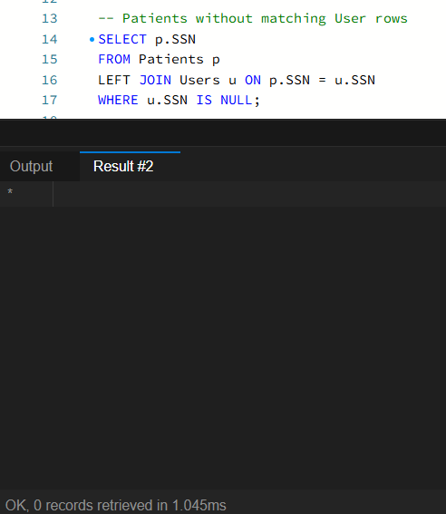
- **1.2 Appointments referencing inactive or non-Doctor users:** 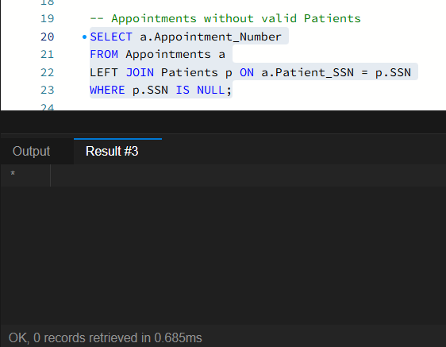
- **1.3 Lab tests referencing inactive or non-Lab-Assistant users:** 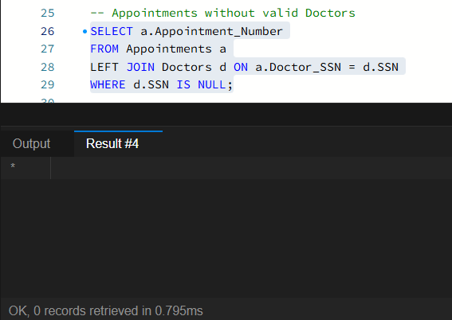
- **1.4 Duplicate user email addresses:** 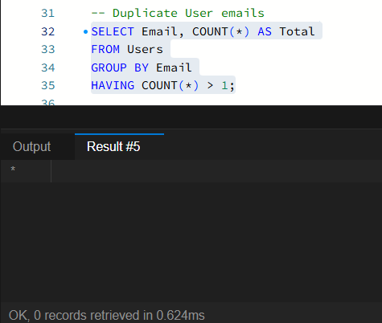
- **1.5 High-risk assessments missing notifications:** 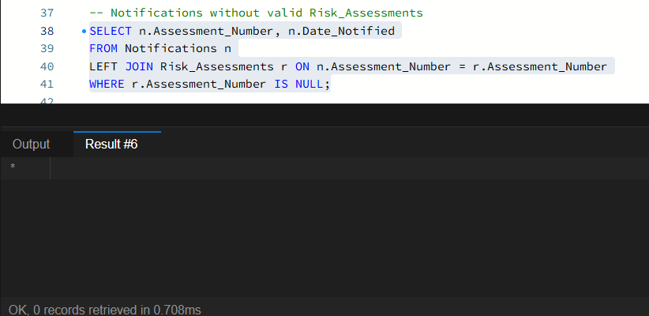
- **1.6 Risk assessments whose `Risk_Level` does not match `Risk_Thresholds`:** 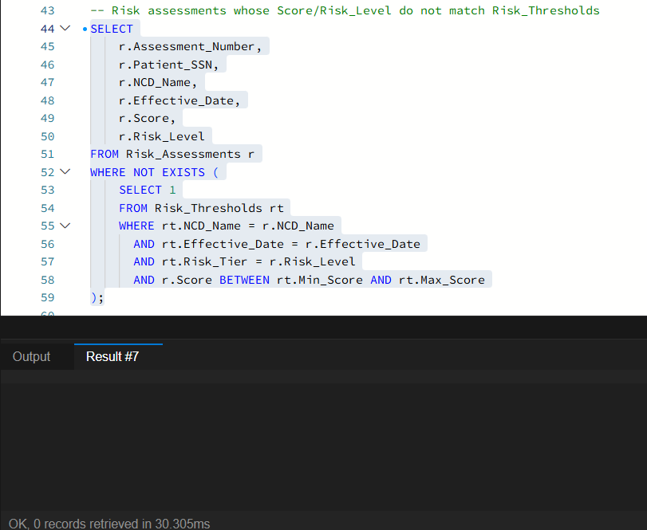

---

## 2. Clinical Relationship Verification Queries

- **2.1 Patients with User details:** 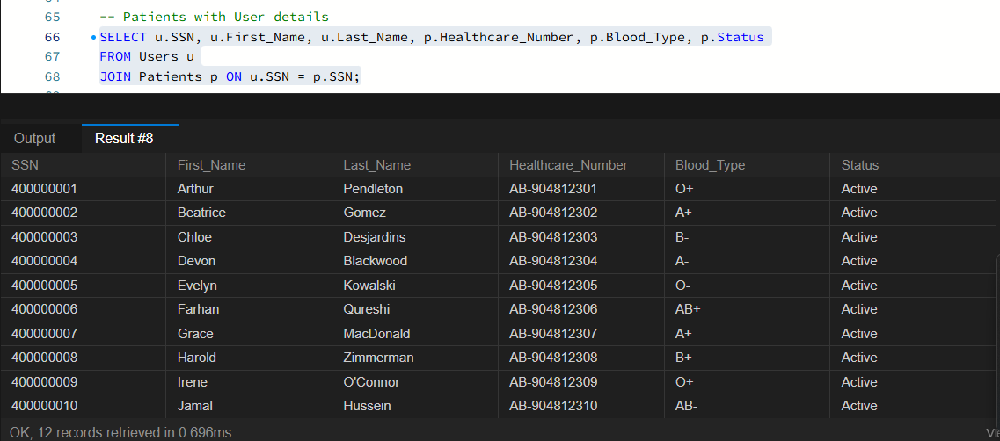
- **2.2 Appointments with Patient and Doctor details:** 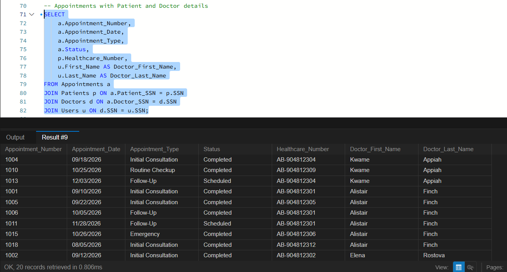
- **2.3 Distinct patient count by risk level:** 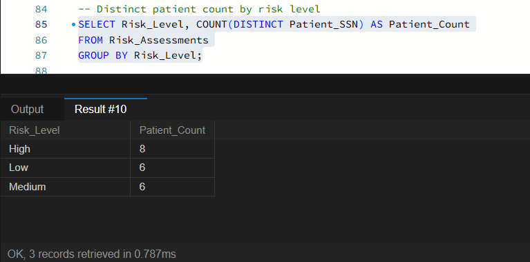
- **2.4 High-risk assessments and linked notifications:** 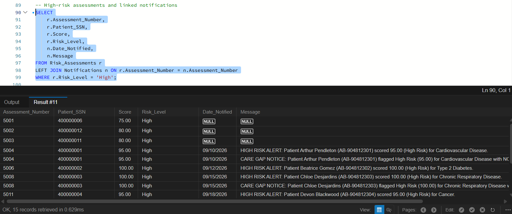
- **2.5 Patients with diagnoses:** 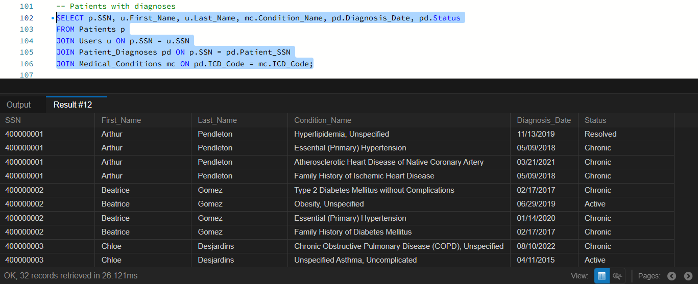
- **2.6 Lab results with test reference ranges:** 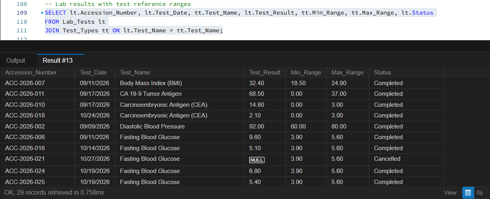
- **2.7 Prescriptions with medication names:** 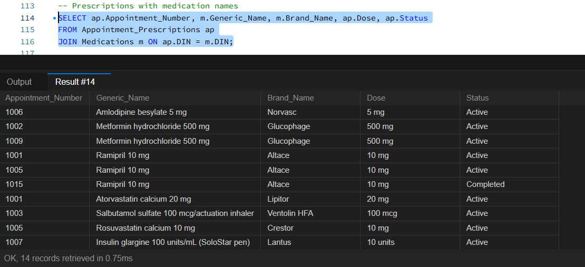
- **2.8 Treatments with treatment names:** 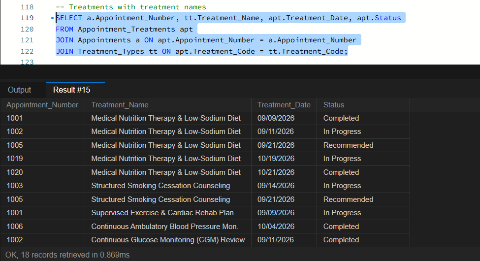

---

## 3. Positive DML & Cascade Tests

| Test ID | Category | Expected outcome | Actual MySQL output | Screenshot | Pass/Fail |
| --- | --- | --- | --- | --- | --- |
| DML-INSERT-USER | Positive DML | Test user inserted | Rows found: 1 | 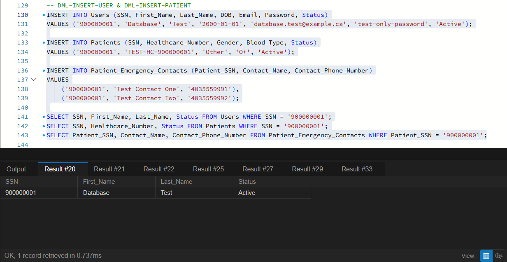 | PASS |
| DML-INSERT-PATIENT | Positive DML | Test patient & emergency contacts inserted | Rows found: 1 (2 contacts) | 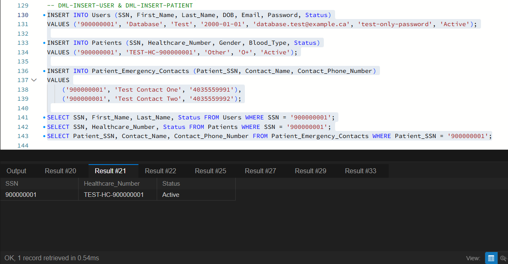 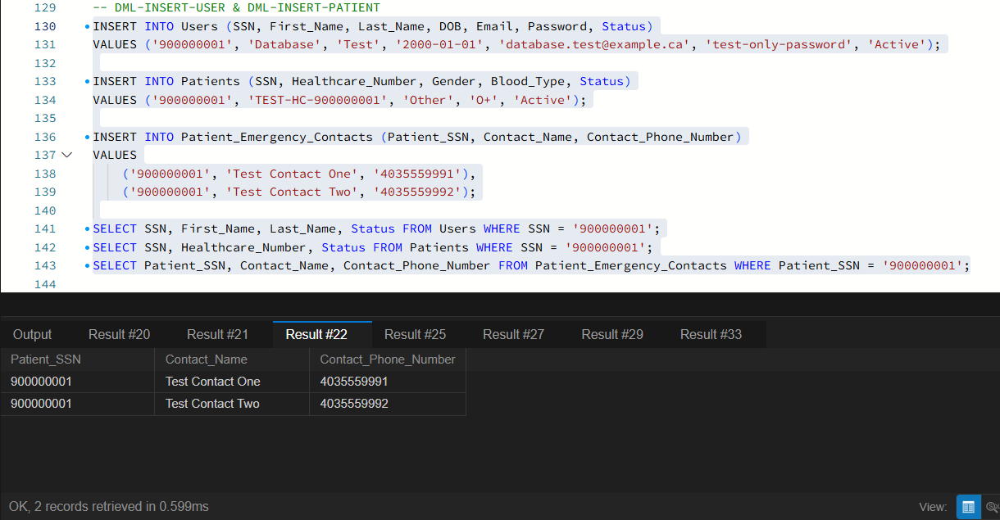 | PASS |
| DML-UPDATE-USER | Positive DML | Test user status changes to `Suspended` | Status: `Suspended` | 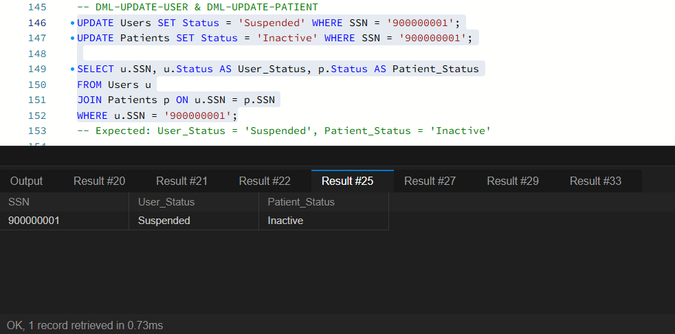 | PASS |
| DML-UPDATE-PATIENT | Positive DML | Test patient status changes to `Inactive` | Status: `Inactive` |  | PASS |
| DML-DELETE-CONTACT | Positive DML | One test contact deleted; one remains | Remaining test contacts: 1 | 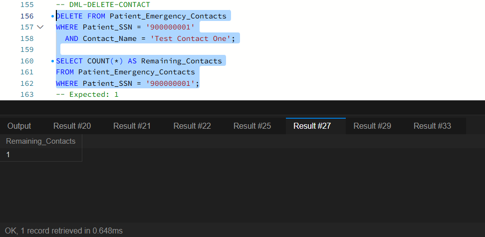 | PASS |
| DML-DELETE-PATIENT | Positive DML | Test patient and dependent contacts deleted (`ON DELETE CASCADE`) | Patients: 0; contacts: 0 | 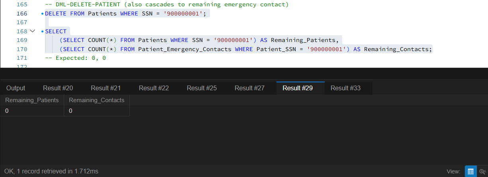 | PASS |
| DELETE-CASCADE-THRESHOLD | ON DELETE | Deleting a test `Risk_Model` removes its `Risk_Thresholds` | Remaining model rows: 0; threshold rows: 0 | 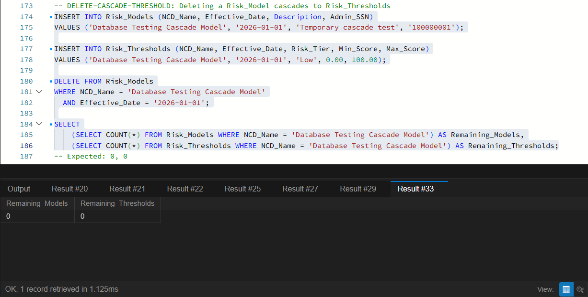 | PASS |

---

## 4. Negative Constraint-Rejection Tests

| Test # | Category | Expected outcome | Actual MySQL output/error | Screenshot | Pass/Fail |
| --- | --- | --- | --- | --- | --- |
| Test 1 | PK / UNIQUE | Duplicate user SSN (`400000001`) rejected (`1062`) | `1062`: Duplicate entry for `users.PRIMARY` | 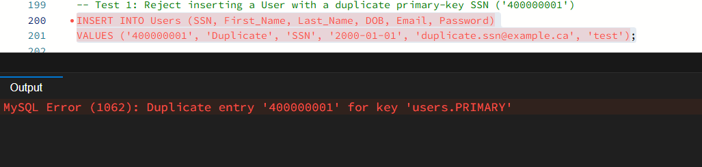 | PASS |
| Test 2 | PK / UNIQUE | Duplicate user email rejected (`1062`) | `1062`: Duplicate entry for `users.UQ_Users_Email` | 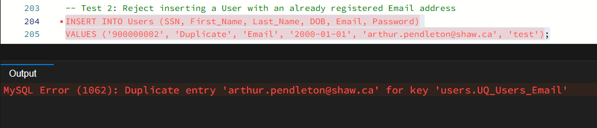 | PASS |
| Test 3 | PK / UNIQUE | Duplicate healthcare number rejected (`1062`) | `1062`: Duplicate entry for `patients.UQ_Patients_Healthcare_Number` | 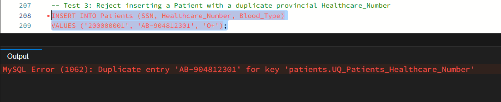 | PASS |
| Test 4 | PK / UNIQUE | Duplicate doctor license rejected (`1062`) | `1062`: Duplicate entry for `doctors.UQ_Doctors_License` | 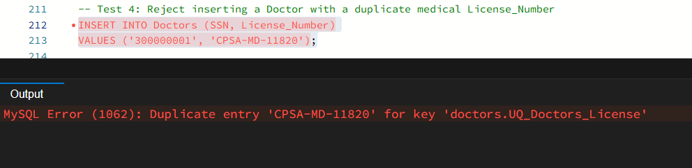 | PASS |
| Test 5 | PK / UNIQUE | Duplicate employee number rejected (`1062`) | `1062`: Duplicate entry for `health_professionals.UQ_Health_Professionals_Emp_No` | 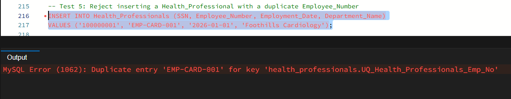 | PASS |
| Test 6 | PK / UNIQUE | Duplicate lab certification rejected (`1062`) | `1062`: Duplicate entry for `lab_assistants.UQ_Lab_Assistants_Cert_No` | 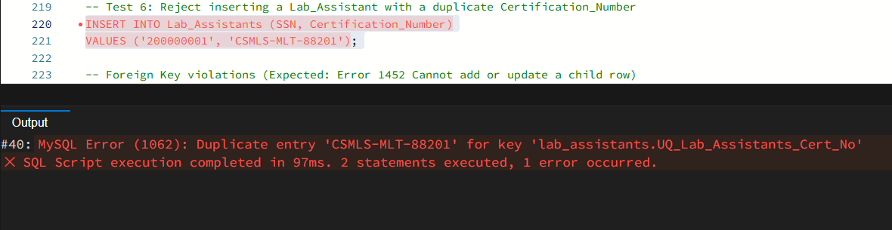 | PASS |
| Test 7 | Foreign key | Lab assistant (`300000001`) cannot be assigned as appointment doctor (`1452`) | `1452`: Foreign key constraint `FK_Appointments_Doctors` failed | 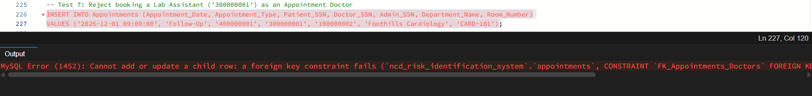 | PASS |
| Test 8 | Foreign key | Nonexistent department/room pair (`ZZ99`) rejected (`1452`) | `1452`: Foreign key constraint `FK_Appointments_Rooms` failed | 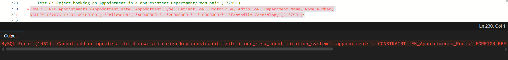 | PASS |
| Test 9 | CHECK | Eight-digit SSN (`12345678`) rejected (`3819`) | `3819`: `CK_Users_SSN` violated | 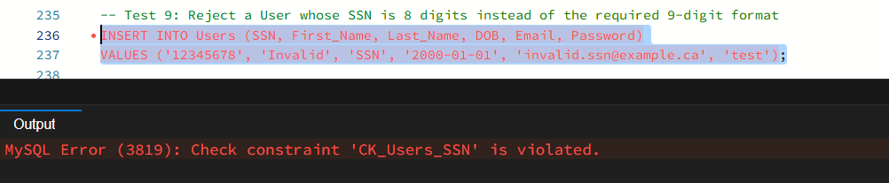 | PASS |
| Test 10 | CHECK | Alphanumeric 8-character DIN (`1234567a`) rejected (`3819`) | `3819`: `CK_Medications_DIN` violated | 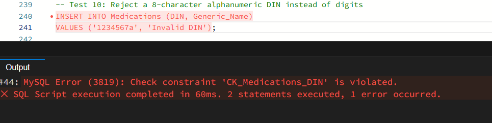 | PASS |
| Test 11 | CHECK | Invalid blood type (`X+`) rejected (`3819`) | `3819`: `CK_Patients_Blood_Type` violated | 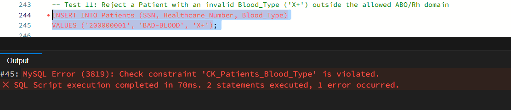 | PASS |
| Test 12 | CHECK | Maximum range below minimum (`10.00 > 5.00`) rejected (`3819`) | `3819`: `CK_Test_Types_Range` violated | 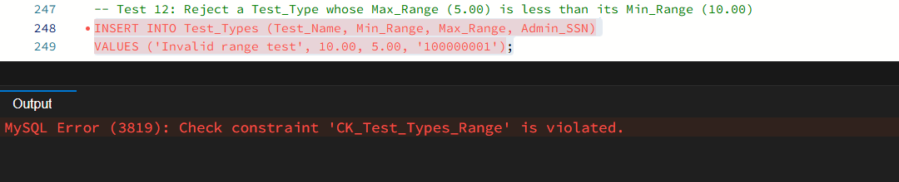 | PASS |
| Test 13 | CHECK | Negative risk score (`-1.00`) rejected (`3819`) | `3819`: `CK_Risk_Assessments_Score` violated | 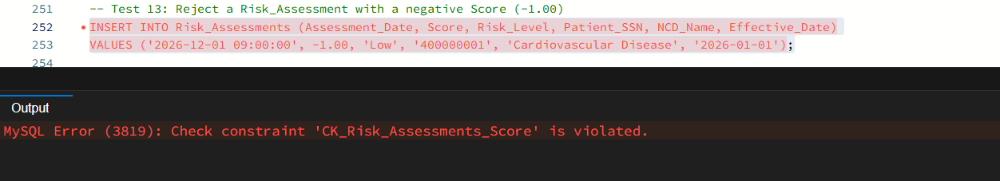 | PASS |
| Test 14 | CHECK | Invalid appointment status (`Booked`) rejected (`3819`) | `3819`: `CK_Appointments_Status` violated | 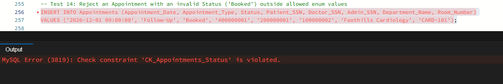 | PASS |
| Test 15 | NOT NULL omission | Omitted mandatory `Users.Email` rejected (`1364`) | `1364`: Field `Email` doesn't have a default value | 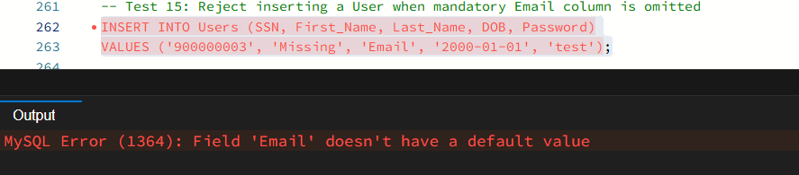 | PASS |
| Test 16 | NOT NULL omission | Omitted mandatory `Appointments.Patient_SSN` rejected (`1364`) | `1364`: Field `Patient_SSN` doesn't have a default value | 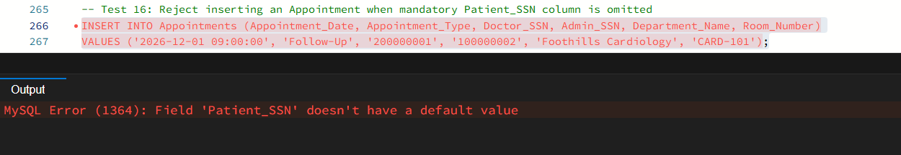 | PASS |
| Test 17 | NOT NULL | Explicit `NULL` `Users.Email` rejected (`1048`) | `1048`: Column `Email` cannot be null | 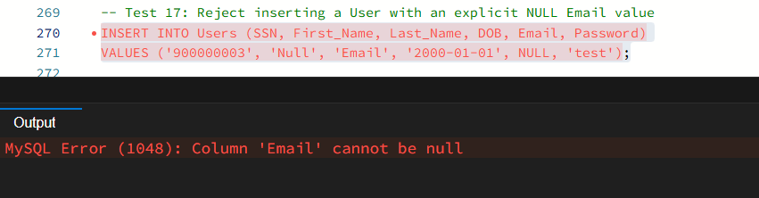 | PASS |
| Test 18 | NOT NULL | Explicit `NULL` `Appointments.Patient_SSN` rejected (`1048`) | `1048`: Column `Patient_SSN` cannot be null | 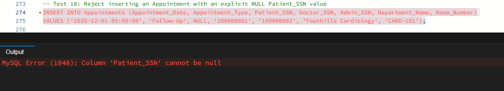 | PASS |
| Test 19 | ON DELETE | Deleting a doctor (`200000001`) referenced by appointments rejected (`1451`) | `1451`: Foreign key constraint `FK_Appointments_Doctors` failed | 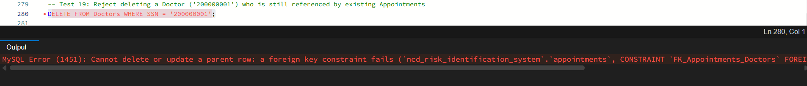 | PASS |
